<div align="center">
  
  <h1>课序 · ClassFlow</h1>
  <p><strong>把一学期，排得明明白白。</strong></p>
  <p>本地优先的大学课表：多套课表、年年自动切换的作息、紧凑七天网格、个人功能页、dsh-pet 鲸鱼娘互动桌宠、鲸海夜航壁纸与 Android 桌面小组件。</p>

  <p>
    <a href="https://lcymxm.github.io/classflow/"><strong>在线使用 →</strong></a>
    &nbsp;·&nbsp;
    <a href="https://github.com/lcymxm/classflow/releases/download/v1.11.1/classflow-1.11.1.apk"><strong>下载 Android APK →</strong></a>
    &nbsp;·&nbsp;
    <a href="#本地运行">本地运行</a>
    &nbsp;·&nbsp;
    <a href="#隐私与数据">数据</a>
  </p>

  <p>
    <a href="https://github.com/lcymxm/classflow/actions/workflows/deploy.yml"></a>
    
    
    
    
  </p>
</div>


> 截图使用临时示例数据。实际首次打开不会加载示例课表，而是一张空白课表，等你从第一门课开始。

## 功能亮点

- **不再自动放示例课表**：第一次打开是空白工作台，不再有「示例课表」占位。
- **多套课表**：主课表、实验课表、考研课表……最多 20 套，独立保存课程、日程、作息和壁纸，随时切换或复制。
- **两套可命名作息**：没有「标准作息」这类固定名称，两套作息都可以自己起名、逐节改时间；两套的修改会分别保存，不会切换一次就回到默认值。
- **作息按日期自动循环**：只填月日，不选年份，例如「每年 11 月 1 日起使用作息方案 2」；每年到这一天会自动切换，跨年也按上一轮规则延续。
- **dsh-pet 鲸鱼娘互动桌宠**：首页右下角新增可拖动桌宠；点一下挥手，双击跳跃，会说话，也可以收起。素材来自 [dsh-pet](https://github.com/zhu1090093659/dsh-pet) 的 `whale-girl-refined`。
- **DeepSeek 鲸鱼娘主题**：深海蓝界面、鲸鱼气泡与光束背景、玻璃卡片；主题图标已换成 dsh-pet 鲸鱼娘头像，视觉参考了 [DSH Market](https://dsh-market.com/) 的深海动漫氛围。
- **默认周视图**：新打开页面默认是周课表；想按天看再切到日视图。
- **跳到任意周**：点大周数或顶部周次，弹出周次面板，可直接跳到第几周；不在本周时左下角有「回到本周」快捷按钮。
- **完整七天网格**：周页只保留节次 × 星期的网格课表；桌面端看完整大图，手机端用紧凑的七天网格，不用横向滑动。
- **手机底部导航**：课表 / 日程 / 课程 / 我的；「我的」不再只是打开设置，而是完整个人页。
- **我的页**：当前课表、课程/节数/日程统计、快速换课表、主题切换、壁纸、备份、日历导出、打印和各课表入口都集中在一起。
- **日程与单日表独立页**：日程列表、今日/下一节课、单日课表从周课表页移到「日程与单日」，周课表只留网格。
- **完整教室地点**：网格课程块和单日表都会显示完整教室地点，不再只给部分课程显示。
- **节假日与调休**：内置 2026、2027 年国务院办公厅放假安排。法定节假日自动隐藏当天课程；调休上班的周末会自动显示并标注「班」。
- **自定义周次**：每个时间段都可以逐周勾选；支持全选、单周、双周、清空，不再只能填一个范围。
- **手动选已有课程**：新增课程时不再自动弹出名称列表；点「已有课程」按钮才展开，选中后自动带入老师，省去重复输入。
- **同名 + 同老师才合并**：只有课程名称和老师都相同（或原课程老师为空）才默认合并；同名不同老师会作为另一门课，避免误合并。
- **周次左右滑动**：手机端在周标题区域左右滑动即可切到上一周/下一周，顶部仍保留周次跳转和回到本周。
- **日程**：除了课程，还可以添加全天或带时间的个人日程；统一在「日程与单日」页查看本周日程和单日安排。
- **鲸海夜航壁纸**：新增一张原创深海光束与鲸影壁纸，适合鲸鱼娘主题；加上奶油纸、鼠尾草、晨光、暮色共五种预设，也支持上传照片。
- **预设课表模板**：空白、理工科、文科、医学、考研备考五种起点，创建后仍可自由修改。
- **三种界面主题**：奶油纸、夜读、DeepSeek 鲸鱼娘。顶部主题按钮也可以循环切换；鲸鱼娘图标来自 dsh-pet。
- **首页桌宠**：鲸鱼娘会呼吸、漂浮、挥手、跳跃、说小话；可以拖到喜欢的位置，位置会记住。
- **作息年年循环**：规则只填月日，每年到点自动切换；跨年时上一轮规则延续，不需要每年重设。
- **Android 桌面小组件**：把今日课程放到手机桌面，点一下直接打开课序。
- **保留**：课程多时间段、单双周、冲突提示、今日/下一节课、JSON 备份、ICS 日历、打印、PWA 与 Android APK。

## 功能

- **周课表 / 日课表**：一周七天、每日最多 14 节，按真实时间轴排列。
- **多套课表**：课表管理里新建、进入、重命名、复制、删除；每套课表独立。
- **多套作息**：两套作息方案都可改名，可分别编辑并保存，应用后可继续逐节调整。
- **默认周视图**：打开即周课表，也可手动切换日视图。
- **周次跳转**：首页大标题显示第几周，下面附上日期范围；点周数/日期打开周次面板，快速跳转或用「回到本周」返回。
- **预设模板**：空白 / 理工科 / 文科 / 医学 / 考研备考。
- **课程管理**：课程名、老师、地点、备注、颜色；一门课支持多个上课时间段。
- **周次**：每个时段可逐周勾选第 1–30 周中的任意周，也可一键全选、单周、双周。
- **同课合并**：同名课程可先点「已有课程」带入原课程和老师；同老师时合并时间段，不同老师默认新建。
- **日程与单日**：单日课程表、当天日程、本周日程、今日/下一节课、本周负担与最忙的一天。
- **日程**：全天或时间段；可改颜色、备注；从顶部日历按钮或「日程与单日」页添加。
- **节假日**：放假日课程自动隐藏，调休上班日显示「班」；开关在设置里。
- **壁纸**：五种预设（含鲸海夜航）+ 上传图片；遮罩强度可调。
- **备份与迁移**：JSON 完整备份 / 导入（包含全部课表、作息、日程和壁纸）；ICS 导出可导入 Google、Apple、Outlook 日历。
- **打印 / PDF**：网页版一键打印当前课表。
- **Android 桌面小组件**：显示今日课程，适配桌面卡片尺寸，点击打开完整课表。
- **奶油纸 / 夜读 / DeepSeek 鲸鱼娘** 三种主题，移动端适配，PWA 离线可用。
- **本地优先**：没有账号、没有后端、没有统计。

### 日视图


### 课程库


### 自定义周次与同课合并

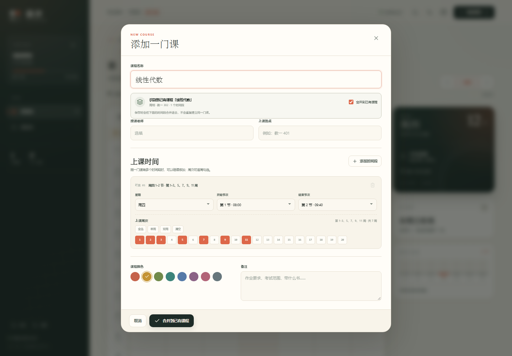

### 手动选择已有课程

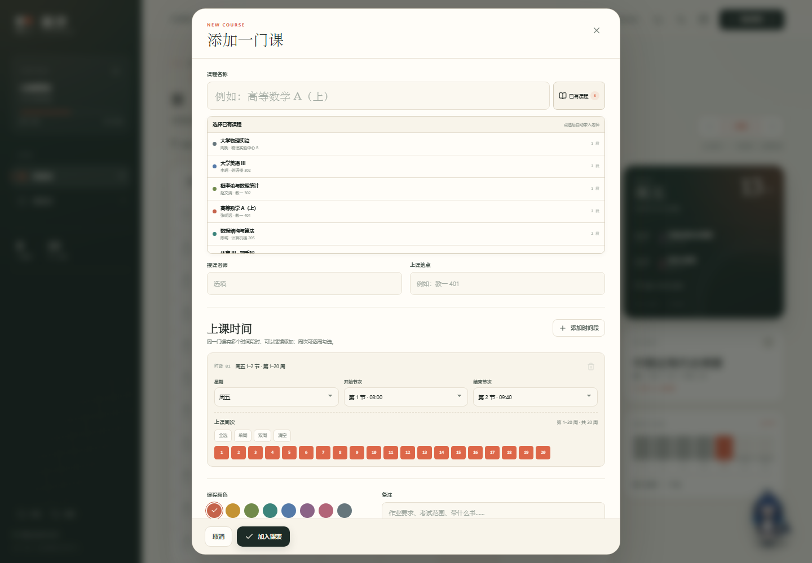

### 左右滑动切换周次

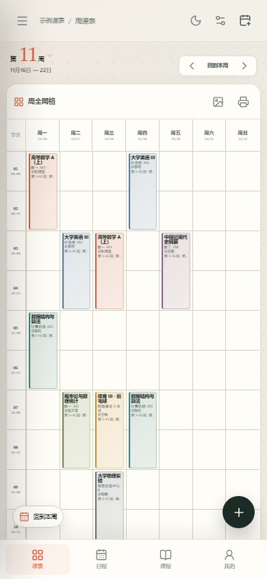

### DeepSeek 鲸鱼娘主题

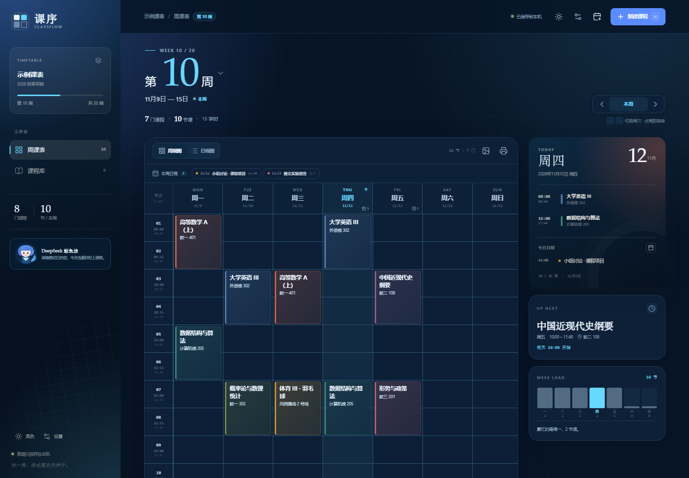

### 我的页

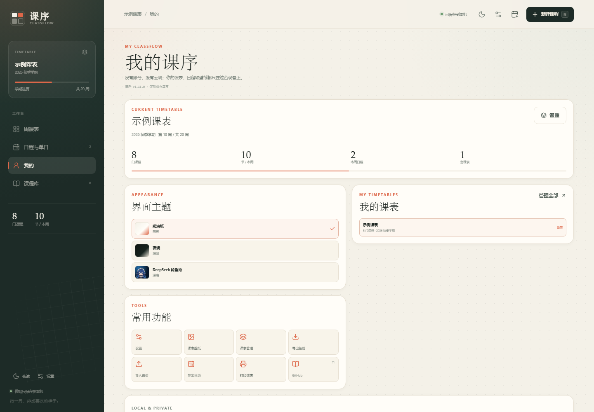

<p align="center">
  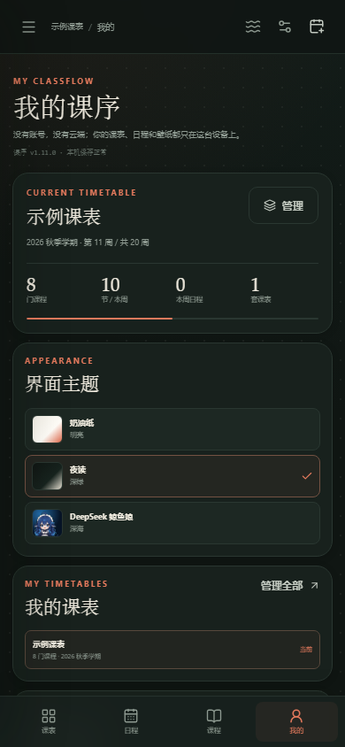
</p>

### 作息按日期自动循环


### 鲸鱼娘桌宠

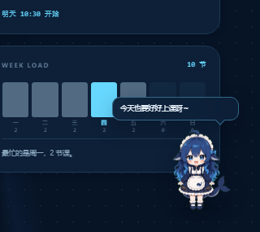

### 日程与单日表

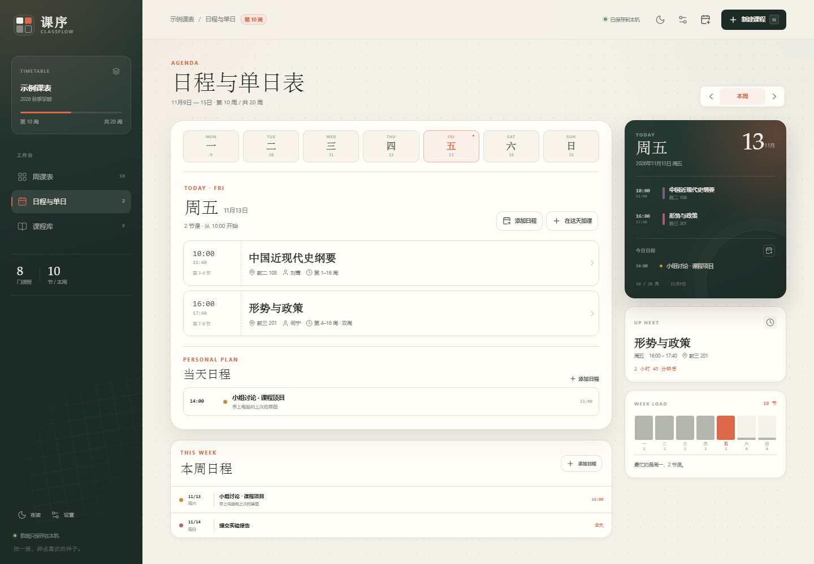

<p align="center">
  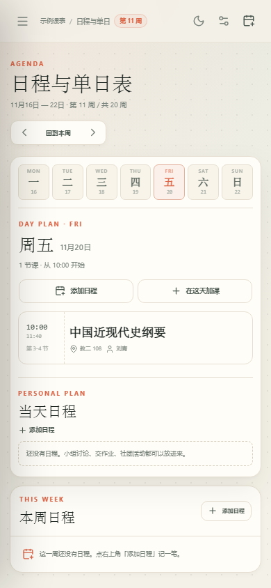
</p>

> 非官方同人主题，鲸鱼娘素材来自 dsh-pet（MIT）；与 DeepSeek 官方无隶属关系。

### 跳到任意周

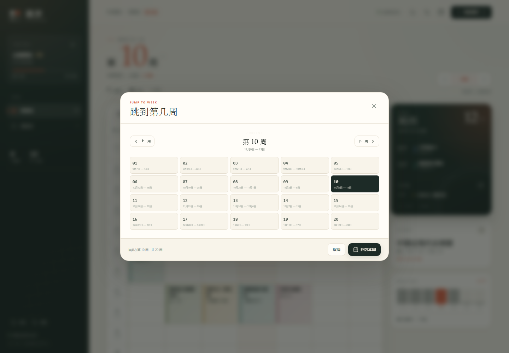

### 预设课表模板

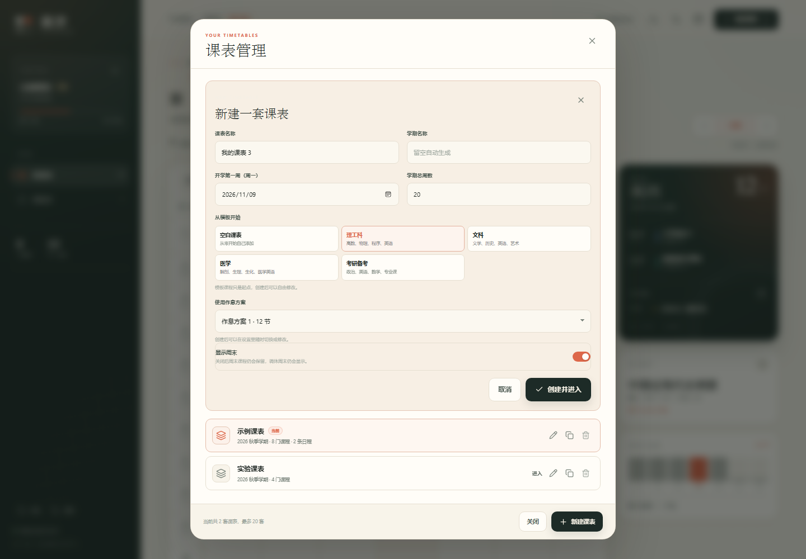

### 主题选择

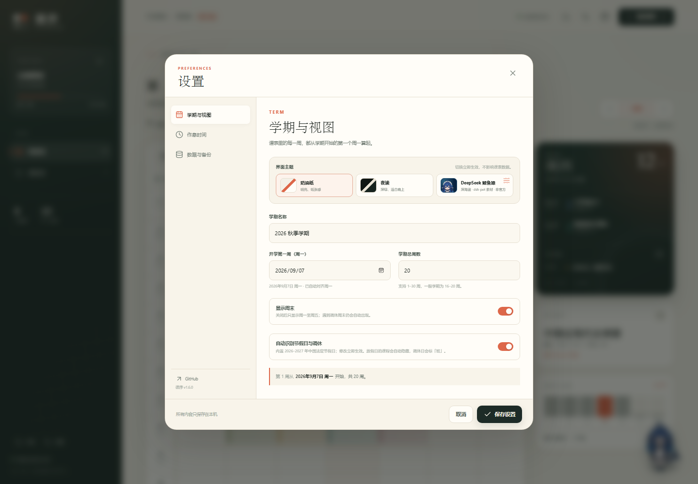

### 多套课表


### 作息可以自己命名

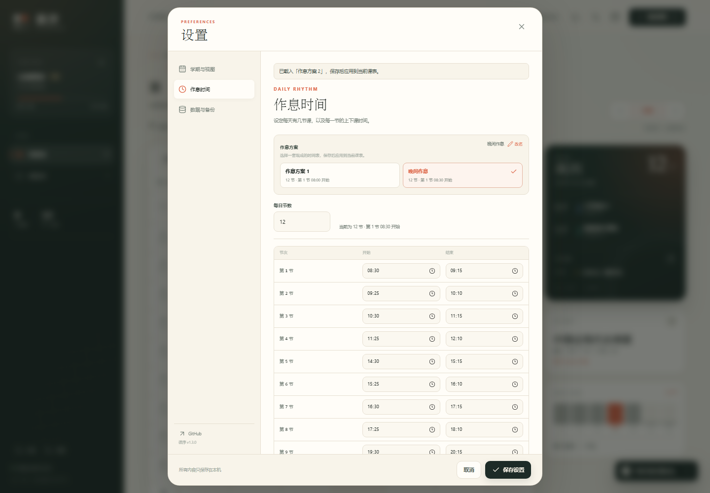

### 鲸海夜航壁纸


### 节假日与调休


<p align="center">
  
  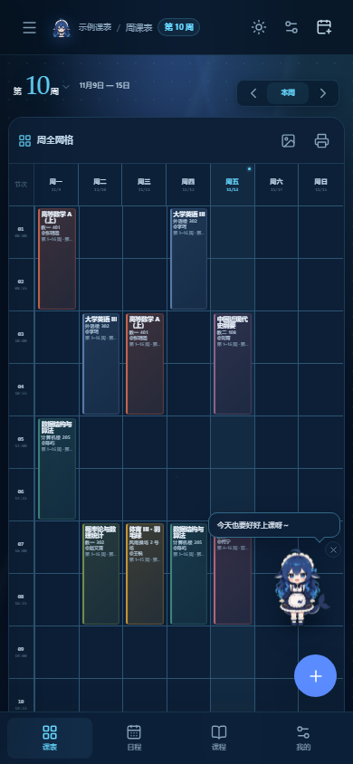
</p>

## 在线使用

打开 **<https://lcymxm.github.io/classflow/>** 即可。

支持「添加到主屏幕」：在桌面 Chrome / Edge 地址栏右侧点安装图标，或在手机浏览器菜单中选择「添加到主屏幕」。第一次打开后，断网也能继续查看课表。

## Android APK

[**下载 Android 离线版 APK（v1.11.1）→**](https://github.com/lcymxm/classflow/releases/download/v1.11.1/classflow-1.11.1.apk)

- 最低系统：Android 7.0（API 24）
- 包名：`io.github.lcymxm.classflow`
- 版本：`1.11.1` · release 签名；证书 SHA-256：`DDEB950B349935E3E47194434CED43CD8ECEC52465AE561B1EF17EB7664B0B6B`
- 首次安装需要在系统设置中允许「安装未知应用」。
- APK 已内置全部页面资源，打开时**不需要访问 GitHub Pages**；数据仍只保存在手机本机。
- APK 内导出备份 / 日历会打开 Android 系统分享面板，可保存到「文件」或网盘；打印 / PDF 请使用网页版。
- 更新 APK 时请下载新版本；同一签名下覆盖安装，数据会保留。

### Android 桌面小组件

安装 APK 后，长按桌面空白处 → 小组件/微件 → 选择「课序 · 今日课程」→ 拖到桌面。

小组件会显示今天的课程和时间，点击可直接打开课序。打开或修改课表后会自动同步；应用会缓存未来两周的课表，日期变化时小组件仍能自动切换。

> 小组件需要 Android 桌面启动器支持；不同品牌的入口名称可能是「小组件」「微件」或「桌面工具」。

> 目前是 GitHub Release 直接下载，未上架 Google Play。

## 本地运行

需要 Node.js 22.12+ 与 pnpm。

```bash
pnpm install
pnpm dev
```

打开 <http://127.0.0.1:5173>。

构建与预览：

```bash
pnpm build
pnpm preview
```

运行测试：

```bash
pnpm test
```

## 快捷键

| 按键 | 作用 |
| --- | --- |
| `N` | 新建课程 |
| `E` | 新建日程 |
| `←` / `→` | 切换上一周 / 下一周 |
| `T` | 回到当前周 |
| `Esc` | 关闭弹窗 / 收起手机端导航 |

## 隐私与数据

- 所有课表、课程、日程、壁纸和偏好保存在 **本机 localStorage**（APK 中为应用自身的 WebView 本地存储）。
- 不发起账号、分析或同步请求，不加载外部字体和图标。
- 换设备前，请到「设置 → 数据与备份 → 导出全部课表备份」导出 JSON，再在新设备导入。
- 清理浏览器站点数据或卸载应用会同时清除课表；建议定期导出备份。
- 自定义壁纸会压缩后保存在本机，并且包含在 JSON 备份里。

## 技术栈

- **React 19 + TypeScript + Vite 8**
- **Capacitor 8 + Android**：离线 APK、原生分享导出、App Widget 桌面小组件
- 原生 CSS，无 UI 框架；自定义网格课表与对话框
- 自写 Service Worker + Web App Manifest，实现离线与安装
- Vitest 单元测试：日期 / 周次 / 重叠布局 / 导入校验 / 节假日 / 模板 / 小组件数据 / ICS 导出
- GitHub Actions 自动构建并部署到 GitHub Pages / 构建签名 APK

## 目录

```text
classflow/
├─ src/
│  ├─ components/       # 课表、课表管理、日程、壁纸、设置、弹窗
│  ├─ lib/              # 日期、作息、节假日、壁纸、存储、备份与 ICS
│  ├─ test/             # Vitest 测试
│  ├─ App.tsx
│  └─ styles.css
├─ public/              # favicon、PWA manifest、Service Worker、图标
├─ android/             # Capacitor Android 工程
├─ assets/              # APK 图标源文件
├─ capacitor.config.ts  # Android 容器配置
├─ docs/                # README 截图
├─ .github/workflows/   # GitHub Pages / Android APK 自动构建
└─ vite.config.ts
```

## 部署

推送到 `main` 后会自动跑测试、构建并发布到 GitHub Pages：

```text
.github/workflows/deploy.yml
```

推送 `v*` 标签时，会额外构建并签名 Android APK，自动创建 Release 并附上 APK 和 SHA-256：

```text
.github/workflows/android.yml
```

`vite.config.ts` 使用相对 `base`，因此部署在任意子路径都可以正常工作。

## 说明

- 第一次打开为空白课表，不再自动加载示例；可以从「添加第一门课」开始。
- 内置 2026/2027 年节假日与调休安排：放假日课程自动隐藏，调休日显示「班」。具体某所学校「补哪一天的课」由校历决定，应用不会猜测；如有需要，可在调休日手动加课。
- 作息方案没有固定名称，两套都可以在设置里改名；方案是模板，应用后会复制到当前课表，之后逐节修改只影响当前课表。
- 页面的默认视图是周视图；切换到日视图后会记住你的选择。
- 日期作息按每周周日判断生效规则；规则只保存月日，每年循环，不选年份。如果 11 月 1 日开始新作息，则 10 月 26 日—11 月 1 日这一周显示新作息；周中日期会整周采用新方案。
- 鲸鱼娘素材为非官方同人作品，角色与 DeepSeek 相关权利归 DeepSeek；素材来自 dsh-pet 的 `whale-girl-refined`（pet.json 标注 MIT），原始主题来源标注 powerdog996 / DreamSkin。详见 [NOTICE](public/pets/whale-girl-refined/NOTICE.txt)。
- 视觉氛围参考 [DSH Market](https://dsh-market.com/)；不包含官方素材。
- 预设课表只会在「课表管理 → 新建课表」时按你的选择生成，不会自动塞进空白课表。
- Android 小组件只适用于 APK 版本，需要桌面启动器支持。小组件已通过构建检查；当前环境没有 Android 真机，实际桌面效果需要你安装后确认。
- 同课合并现在同时看课程名称和老师：同名同老师才自动合并；同名不同老师会新建，避免把两个班混在一起。已有课程老师为空时，可先选已有课程带入老师。
- 手机端周标题区域左右滑动切换周次。
- 手机端周课表是一张紧凑的完整七天网格，课程块内显示课程、教室、老师和周次；不需要横向滑动。首页大标题显示「第几周」，下方再附日期范围。
- 手机底部导航提供「课表 / 日程 / 课程 / 我的」四个入口。
- 日程和单日课表统一在「日程与单日」页；周课表页只显示课程网格。
- 课程冲突目前只会提示并并排展示，不会自动调整课程时间。
- 这是个人课表工具，不包含教务系统登录或自动抓取课表功能。

## 第三方素材

- **dsh-pet · whale-girl-refined**：桌宠动画与主题头像来自 [zhu1090093659/dsh-pet](https://github.com/zhu1090093659/dsh-pet) 的 `assets/whale-refined/`。该 pet.json 标注 MIT；dsh-pet 仓库为 Apache-2.0。
- 精致版参考 DreamSkin 的「DeepSeek-鲸鱼娘」主题，原始主题作者标注为 `powerdog996`（MIT）。
- 角色为非官方同人鲸鱼娘；DeepSeek 名称与鲸鱼标志归 DeepSeek，本项目与官方无隶属关系，素材仅用于免费非商业项目。
- 完整归属、MIT 文本与文件说明：`public/pets/whale-girl-refined/NOTICE.txt`。

## License

[MIT](LICENSE) © 2026 [lcymxm](https://github.com/lcymxm)

---

如果课序让你的学期清楚了一点点，欢迎点一个 Star。
