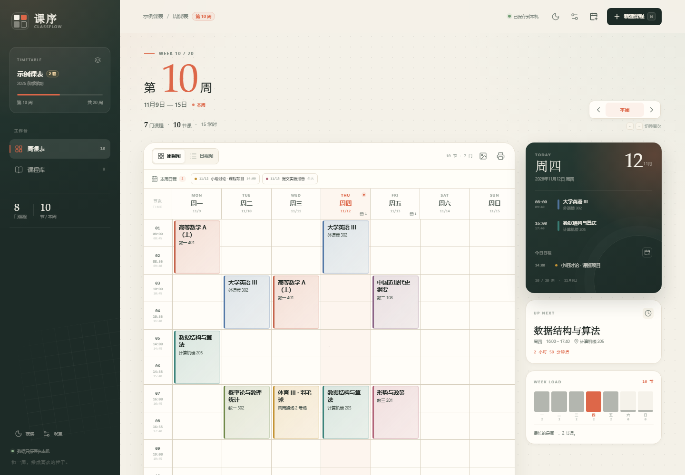
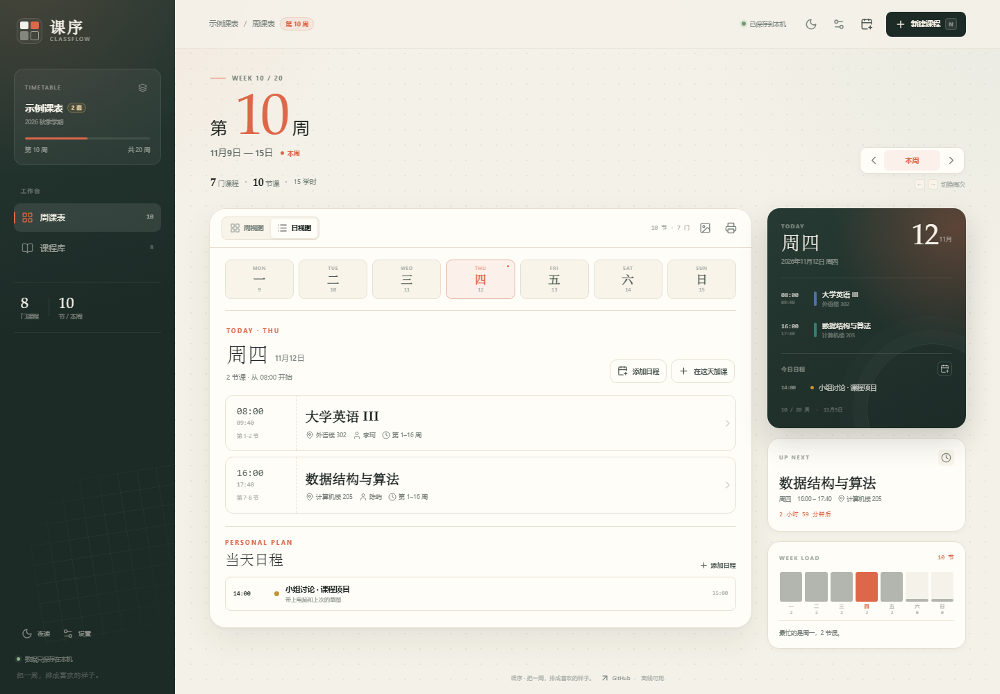
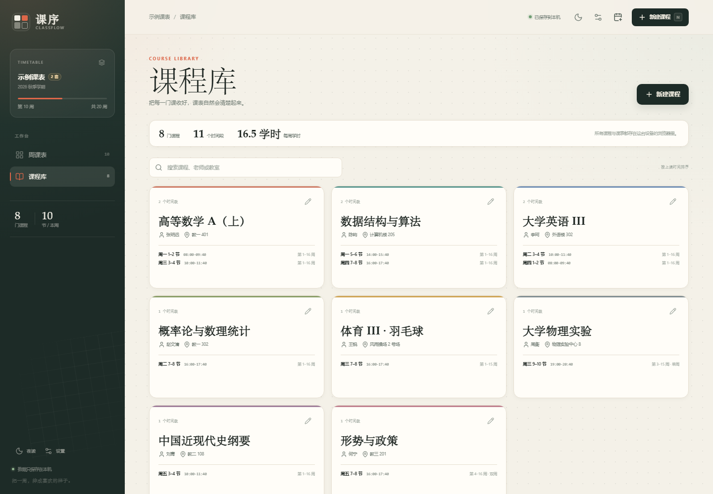
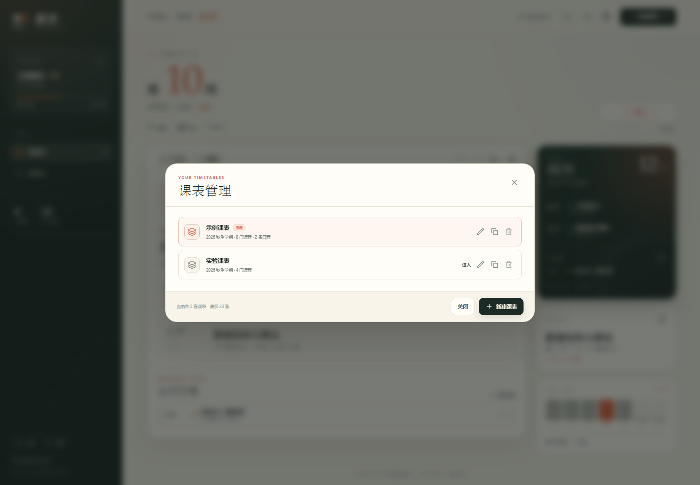
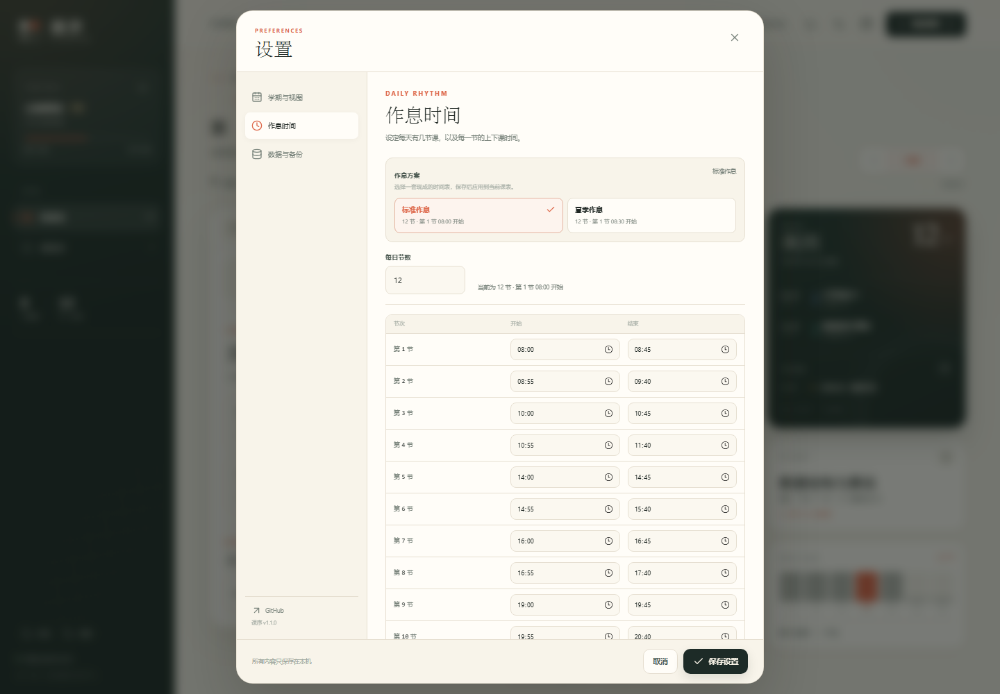
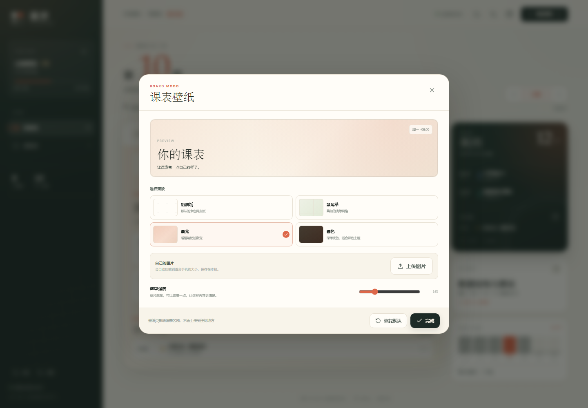
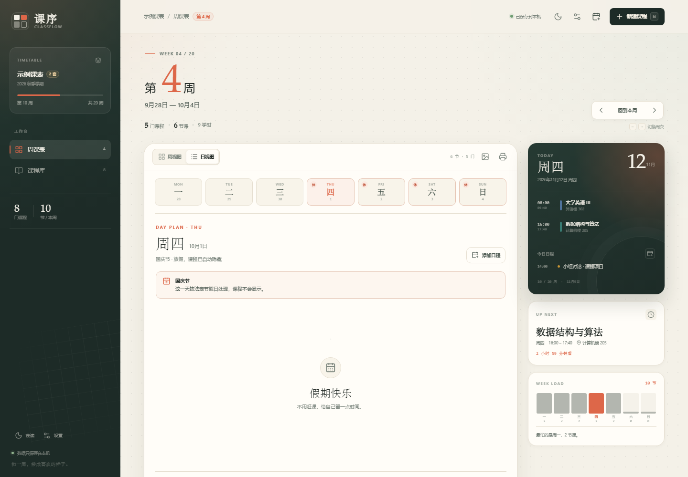
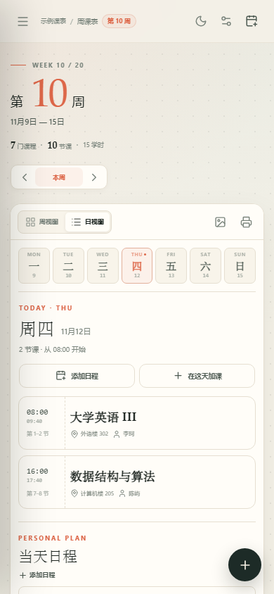

<div align="center">
  
  <h1>课序 · ClassFlow</h1>
  <p><strong>把一学期，排得明明白白。</strong></p>
  <p>本地优先的大学课表：多套课表、多套作息、日程、节假日调休、网格课表、自定义壁纸。</p>

  <p>
    <a href="https://lcymxm.github.io/classflow/"><strong>在线使用 →</strong></a>
    &nbsp;·&nbsp;
    <a href="https://github.com/lcymxm/classflow/releases/download/v1.1.0/classflow-1.1.0.apk"><strong>下载 Android APK →</strong></a>
    &nbsp;·&nbsp;
    <a href="#本地运行">本地运行</a>
    &nbsp;·&nbsp;
    <a href="#隐私与数据">数据</a>
  </p>

  <p>
    <a href="https://github.com/lcymxm/classflow/actions/workflows/deploy.yml"></a>
    
    
    
    
  </p>
</div>



> 截图使用临时示例数据。实际首次打开不会加载示例课表，而是一张空白课表，等你从第一门课开始。

## 这次更新的内容

- **不再自动放示例课表**：第一次打开是空白工作台，不再有「示例课表」占位。
- **多套课表**：主课表、实验课表、考研课表……最多 20 套，独立保存课程、日程、作息和壁纸，随时切换或复制。
- **多套作息时间**：内置「标准作息」和「夏季作息」两套十二节时间表；应用后仍可逐节修改，也可以完全自定义。
- **真正的网格课表**：周视图是一格一格的表格，节次与星期形成清晰网格，课程按节次占据格子。
- **节假日与调休**：内置 2026、2027 年国务院办公厅放假安排。法定节假日自动隐藏当天课程；调休上班的周末会自动显示并标注「班」。
- **日程**：除了课程，还可以添加全天或带时间的个人日程，在周视图、日视图和今日卡片里查看。
- **课表壁纸**：奶油纸、鼠尾草、晨光、暮色四种预设，也可以上传自己的照片；可调遮罩强度，图片只保存在本机。
- **保留**：课程多时间段、单双周、冲突提示、今日/下一节课、JSON 备份、ICS 日历、打印、PWA 与 Android APK。

## 功能

- **周课表 / 日课表**：一周七天、每日最多 14 节，按真实时间轴排列。
- **多套课表**：课表管理里新建、进入、重命名、复制、删除；每套课表独立。
- **多套作息**：标准作息 / 夏季作息两套默认方案，应用后可继续调整。
- **课程管理**：课程名、老师、地点、备注、颜色；一门课支持多个上课时间段。
- **周次与单双周**：每门课可设置第 1–30 周中的范围，并支持每周 / 单周 / 双周。
- **今日视图**：当天课程、下一节课、倒计时、今日日程、本周负担与最忙的一天。
- **日程**：全天或时间段；可改颜色、备注；从顶部日历按钮、日视图或今日卡片添加。
- **节假日**：放假日课程自动隐藏，调休上班日显示「班」；开关在设置里。
- **壁纸**：四种预设 + 上传图片；遮罩强度可调。
- **备份与迁移**：JSON 完整备份 / 导入（包含全部课表、作息、日程和壁纸）；ICS 导出可导入 Google、Apple、Outlook 日历。
- **打印 / PDF**：网页版一键打印当前课表。
- **浅色 / 深色主题**，移动端适配，PWA 离线可用。
- **本地优先**：没有账号、没有后端、没有统计。

### 日视图



### 课程库



### 多套课表



### 作息方案



### 壁纸



### 节假日与调休



<p align="center">
  
</p>

## 在线使用

打开 **<https://lcymxm.github.io/classflow/>** 即可。

支持「添加到主屏幕」：在桌面 Chrome / Edge 地址栏右侧点安装图标，或在手机浏览器菜单中选择「添加到主屏幕」。第一次打开后，断网也能继续查看课表。

## Android APK

[**下载 Android 离线版 APK（v1.1.0）→**](https://github.com/lcymxm/classflow/releases/download/v1.1.0/classflow-1.1.0.apk)

- 最低系统：Android 7.0（API 24）
- 包名：`io.github.lcymxm.classflow`
- 版本：`1.1.0` · release 签名；证书 SHA-256：`DDEB950B349935E3E47194434CED43CD8ECEC52465AE561B1EF17EB7664B0B6B`
- 首次安装需要在系统设置中允许「安装未知应用」。
- APK 已内置全部页面资源，打开时**不需要访问 GitHub Pages**；数据仍只保存在手机本机。
- APK 内导出备份 / 日历会打开 Android 系统分享面板，可保存到「文件」或网盘；打印 / PDF 请使用网页版。
- 更新 APK 时请下载新版本；同一签名下覆盖安装，数据会保留。

> 目前是 GitHub Release 直接下载，未上架 Google Play。

## 本地运行

需要 Node.js 22.12+ 与 pnpm。

```bash
pnpm install
pnpm dev
```

打开 <http://127.0.0.1:5173>。

构建与预览：

```bash
pnpm build
pnpm preview
```

运行测试：

```bash
pnpm test
```

## 快捷键

| 按键 | 作用 |
| --- | --- |
| `N` | 新建课程 |
| `E` | 新建日程 |
| `←` / `→` | 切换上一周 / 下一周 |
| `T` | 回到当前周 |
| `Esc` | 关闭弹窗 / 收起手机端导航 |

## 隐私与数据

- 所有课表、课程、日程、壁纸和偏好保存在 **本机 localStorage**（APK 中为应用自身的 WebView 本地存储）。
- 不发起账号、分析或同步请求，不加载外部字体和图标。
- 换设备前，请到「设置 → 数据与备份 → 导出全部课表备份」导出 JSON，再在新设备导入。
- 清理浏览器站点数据或卸载应用会同时清除课表；建议定期导出备份。
- 自定义壁纸会压缩后保存在本机，并且包含在 JSON 备份里。

## 技术栈

- **React 19 + TypeScript + Vite 8**
- **Capacitor 8 + Android**：离线 APK，原生分享导出
- 原生 CSS，无 UI 框架；自定义网格课表与对话框
- 自写 Service Worker + Web App Manifest，实现离线与安装
- Vitest 单元测试：日期 / 周次 / 重叠布局 / 导入校验 / 节假日 / ICS 导出
- GitHub Actions 自动构建并部署到 GitHub Pages / 构建签名 APK

## 目录

```text
classflow/
├─ src/
│  ├─ components/       # 课表、课表管理、日程、壁纸、设置、弹窗
│  ├─ lib/              # 日期、作息、节假日、壁纸、存储、备份与 ICS
│  ├─ test/             # Vitest 测试
│  ├─ App.tsx
│  └─ styles.css
├─ public/              # favicon、PWA manifest、Service Worker、图标
├─ android/             # Capacitor Android 工程
├─ assets/              # APK 图标源文件
├─ capacitor.config.ts  # Android 容器配置
├─ docs/                # README 截图
├─ .github/workflows/   # GitHub Pages / Android APK 自动构建
└─ vite.config.ts
```

## 部署

推送到 `main` 后会自动跑测试、构建并发布到 GitHub Pages：

```text
.github/workflows/deploy.yml
```

推送 `v*` 标签时，会额外构建并签名 Android APK，自动创建 Release 并附上 APK 和 SHA-256：

```text
.github/workflows/android.yml
```

`vite.config.ts` 使用相对 `base`，因此部署在任意子路径都可以正常工作。

## 说明

- 第一次打开为空白课表，不再自动加载示例；可以从「添加第一门课」开始。
- 内置 2026/2027 年节假日与调休安排：放假日课程自动隐藏，调休日显示「班」。具体某所学校「补哪一天的课」由校历决定，应用不会猜测；如有需要，可在调休日手动加课。
- 作息方案是模板：应用后会复制到当前课表，之后在设置里逐节修改只影响当前课表。
- 课程冲突目前只会提示并并排展示，不会自动调整课程时间。
- 这是个人课表工具，不包含教务系统登录或自动抓取课表功能。

## License

[MIT](LICENSE) © 2026 [lcymxm](https://github.com/lcymxm)

---

如果课序让你的学期清楚了一点点，欢迎点一个 Star。
